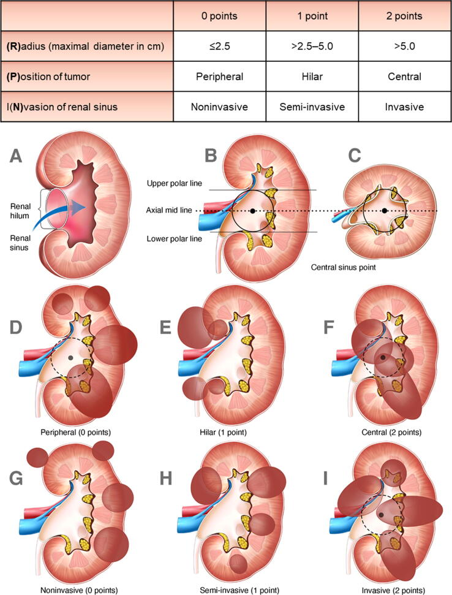

# kidney-tumor-radiomics
Extraction of radiomic features from segmentated kidney tumors.

## Grading system
The grading of the tumor will be done using RPN (Radius, Position of tumour, iNvasion of renal sinus), as described in: https://pmc.ncbi.nlm.nih.gov/articles/PMC10397239/ or on the figure below.

## Data annotation
- Label the data viewing it with 3D Slicer app. 
- Share the csv file for annotation via Google Sheets, download it after it is completed

# Notes

Tumours may be noninvasive, semi-invasive, or invasive. Noninvasive tumours are partly or predominantly exophytic peripheral tumours and have a clear rim of normal parenchyma between the tumour and the renal sinus. Semi-invasive tumours include three distinct types: (1) peripheral tumours touching the renal sinus; (2) completely endophytic tumours confined within the renal parenchyma; and (3) hilar tumours that are superficial and not invading the renal sinus. Invasive tumours are those that extend into the renal sinus. Thus, peripheral tumours can be noninvasive, semi-invasive, or invasive. Hilar tumours can be semi-invasive or invasive, and all central tumours are exclusively invasive (Fig. 1).

# Implementation

## Launching
after geting the repo, kits23 and the raw annotation from google drive (.xlsx) ready run:
1. `analyze_kits23_tumor_instances.py` - to genereate `tumor_instance_data.json`
2. `apply_original_annotation.py` - self explanatory
3. `apply_tumor_size_limit.py` - remove tumors that are too large from the dataframe

Now the .csv is shared with annotation specialists (medical professionals specialising in Urology)

After getting the .csv with annotations, to prepare the training data, run:
1. `analyze_annotated_data.ipynb` - self explanatory
2. `compile_dataset.py` - run to produce a drectory - with standardized input data and labels, and visualisation for the data distribution in this dataset

To train a model on a given dataset:
1. `train.py` - a single python script handeling the whole model training and evaluation
    - the script is designed to be ran from the CLI, with several attributes to specify how it is supposed to be trained
    

<!-- 2. `convert_kits_dataset.py` - to generate `/home/marcel/Repos/Data/kits23_converted/` directory and fill it with data prepared for training i.e. segmentations as .npy arrays and labels.csv. -->

## Input standardisation ideas
- [x] create a bounding-box for the kidney-tumor system
- [x] analyze the annotated data
- [ ] make sure processed masks do not delete the tumor, print a warning, maybe throw an error
- [x] stratified group k-fold validation
- [x] keras class weights - to make the model pay more attention to rare cases
- [x] make the bounding-box work around just the kidney, not the kidney-tumor (since RPN revolves around the position within the kidney, external data should be irrelevant)
- [x] make a generator function with synthetic data generation
- [x] visualize the training data
- [x] visualize the validation data
- [x] add ROC, precision, recall
- [ ] visualize the generated model (weights, etc.)
- [ ] check how well utilized the system's resourcess are
- [x] modify `generate_train_validation_split`, such that it confirms there is no cross-contamination between cases
- [ ] add a descriptor to fold out directories
- [x] add a confusion matrix (2 separate ones, I think)
- [ ] save the model
- [ ] should we add argmax to the model?
- [ ] add a model visualization to the figures
- [ ] add a parameter to the learning rate
- [ ] add some "score" value that can grade the different models

### Helpfull tensorflow functions
use one-hot encoding for input? - https://www.tensorflow.org/api_docs/python/tf/one_hot
resize the input image? - https://www.tensorflow.org/api_docs/python/tf/image/resize
use TFRecord for data representation - https://www.tensorflow.org/tutorials/load_data/tfrecord
use tf.data to read TFRecord 

### later adition to this function 
- create synthetic data
- split test - train set taking into account the probablilty of all properties

# Questions
- jak powinny być przygotowane dane do uczenia maszynowego na icm, w jakiej strukturze je zapisać?
- TFRecord, generator vs. preloaded zrobić benchmark generatora, może nie ma sensu jeśli się wczytuje w ciągu sekund to nie ma co się pocić
dataset.save

- jakieś rady co do uruchamiania uczenia na rysach aby była dobra wydajność (nvm. batch size większy może?), jak to ocenić czy dorze działa?
32 lub mniej

- one hot na inpucie? to dane wtedy będą 4 wymiarowe + batch
nie

- jakie biblioteki wykorzystywać do tworzenia syntetycznych danych: keras.layers jak na ćwiczeniach, czy własne funkcje tf?
keras.layers będzie lepiej/ławiej - może własną warstwę zaprojektować 

- jak zrobić dobry pipeline?
czasami można na żywo jak będzie szybkie

- da się wizualizować dane zapisane w ten sposób w miarę bez-problematyczny sposób?
tak

- czy są jakieś sposoby na automatyczny tuning hyperparametrów, coś w kerasie? czy muszę to ręcznie robić?
sklearn - pakiet do optymalizacj

- jakieś inne rady przy tworzeniu modeli które mają później być użyte w aplikacji (format zapisu lub coś)
tf.keras.save

